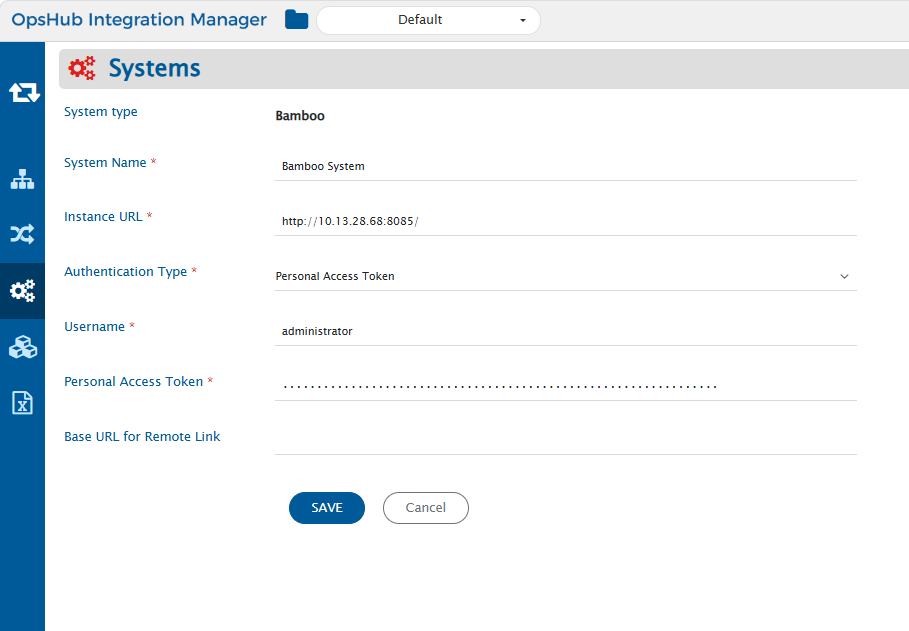
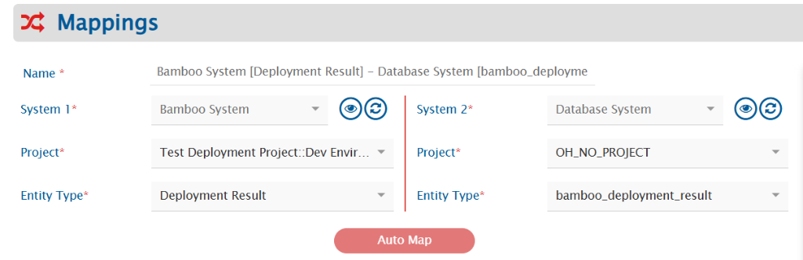
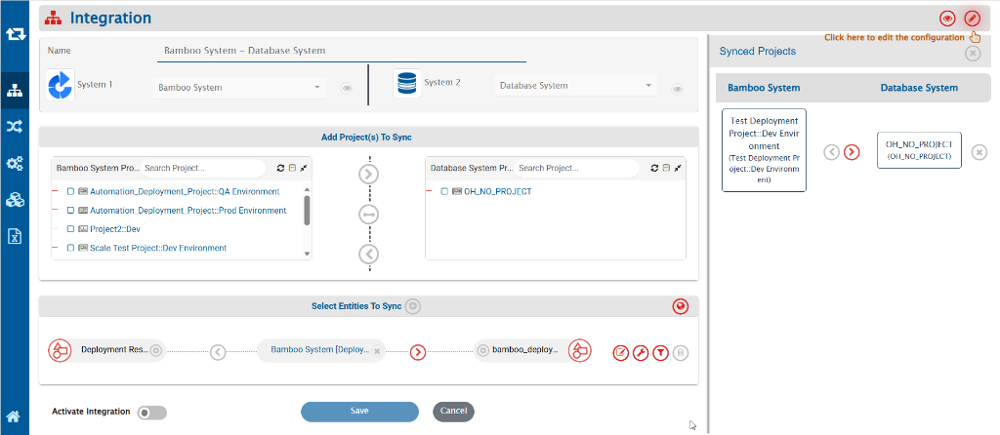
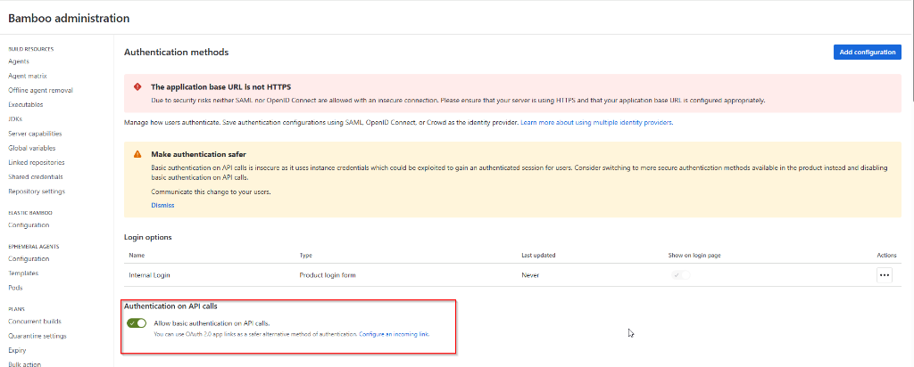
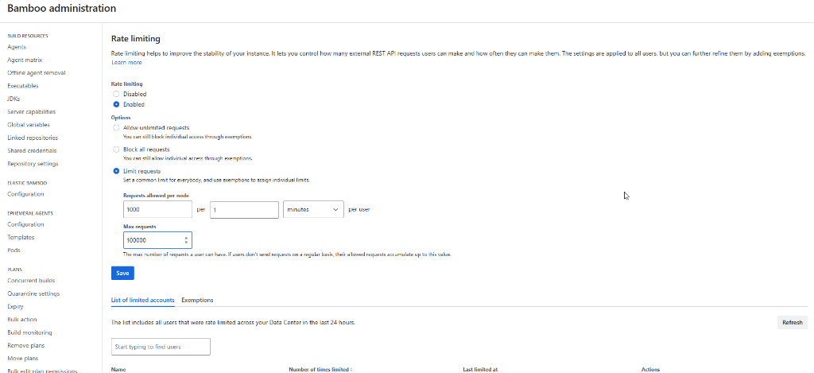

# Prerequisites

## User Privileges

* Create a dedicated user in Bamboo for <code class="expression">space.vars.OIM</code>. This user should not be used to perform any manual operations from the Bamboo user interface. This user is referred to as the **Integration User** throughout the documentation.
* The Integration User must have at least **Read** permission for the Deployment Projects and Environments that need to be synchronized.
* Users can authenticate using a **Personal Access Token (PAT)** (recommended) or **Basic Authentication**. Refer to the [Appendix](#appendix) for details on generating a PAT or enabling basic authentication.

## API Rate Limiting

* In Bamboo Data Center, REST API rate limiting can be configured under **Bamboo Administration > Security > Rate Limiting**.
* To avoid synchronization delays or API throttling during high-frequency polling, it is recommended to add the dedicated integration user to the **Rate Limiting Exemptions** allowlist or increase the request threshold. Refer to [How to Configure Rate Limiting Exemptions in Bamboo](#how-to-configure-rate-limiting-exemptions-in-bamboo) for step-by-step instructions.

# System Configuration

Before you continue to the integration, you must first configure Bamboo in <code class="expression">space.vars.OIM</code>. Click [System Configuration](../integrate/system-configuration.md) to learn the step-by-step process to configure a system.

Refer to the screenshot given below for reference:

  

## Bamboo System Form Details

| Field Name | When is the field visible | Description |
| --- | --- | --- |
| **System Name** | Always | Provide a unique name for the Bamboo system instance. |
| **Instance URL** | Always | Provide the base URL of the Bamboo instance. For example: `http://{hostname}:{port}` or `https://bamboo.yourcompany.com`. |
| **Authentication Type** | Always | Select the authentication method:   • **Personal Access Token** (Recommended): Authenticates via Bearer token.   • **Basic Authentication**: Authenticates via username and password. |
| **Username** | Always | Provide the username of the dedicated user configured to communicate with the Bamboo instance. |
| **Password** | When Authentication Type is **Basic Authentication** | Provide the password for the specified user to access the Bamboo instance. |
| **Personal Access Token** | When Authentication Type is **Personal Access Token** | Provide the Personal Access Token (PAT) generated in Bamboo for the specified user. Refer to [How to Generate a Personal Access Token in Bamboo](#how-to-generate-a-personal-access-token-in-bamboo). |
| **Base URL for Remote Link** | Always | Provide an alternate base URL for the Bamboo instance if links to Bamboo entities should use a different host or public domain than the configured Instance URL.   **Note**: If left blank, the configured Instance URL is used to generate remote links. |

If the system is deployed on HTTPS and a self-signed certificate is used, then you will have to import the SSL Certificate to be able to access the system from <code class="expression">space.vars.OIM</code>. Click [Import SSL Certificates](../getting-started/ssl-certificate-configuration.md) to learn how to import SSL certificate.

# Mapping Configuration

Map the fields between Bamboo and the target system to ensure that the data between both systems synchronizes correctly. Click [Mapping Configuration](../integrate/mapping-configuration.md) to learn the step-by-step process to configure mapping between the systems.

  

In Bamboo, **Deployment Projects** represent parent projects, and **Environments** represent child projects. While configuring mapping, you can select the project scope at the parent project level (Deployment Project) or at the child project level (Environment).

# Integration Configuration

Set a time to synchronize data between Bamboo and the target system. Also, define parameters and conditions, if any, for integration. Click [Integration Configuration](../integrate/integration-configuration.md) to learn the step-by-step process to configure an integration between two systems.

  

## Child Project Synchronization

In Bamboo, **Deployment Projects** act as parent projects and **Environments** act as child projects. When selecting projects in an integration, the synchronization behaves as follows:

| Project Selection | Synchronization Behavior |
| --- | --- |
| **Environment (Child Project)** | Synchronizes deployment results for the selected environment only. |
| **Deployment Project (Parent Project)** | Synchronizes deployment results from all child environments under the selected deployment project. |

> **Note**: Selecting a parent Deployment Project automatically includes all of its environments in the synchronization.

## Criteria Configuration

Criteria-based synchronization is **not supported** for Bamboo Deployment Results as the Bamboo REST API does not provide query or search endpoints with filtering capabilities.

# Known Behaviors and Limitations

* The Bamboo connector supports **Read-only** synchronization for **Deployment Result**. Creating, updating, or deleting deployment results via the API is not supported.
* Looking up or mapping users by email address is **not supported** because Bamboo's search API does not index user email addresses. Users can only be mapped using their **Username** or **Display Name**.
* Deployment Results in Bamboo are immutable records; once created, they cannot be updated or permanently deleted through the API.
* Server-side filtering is not supported by Bamboo API for deployment results; <code class="expression">space.vars.OIM</code> fetches all deployment results for the environment and applies filtering on `startedDate` in memory.
* Although Bamboo's UI displays Jira issues associated with a deployment release, this information is not exposed via the REST API for a deployment result and cannot be synchronized.
* Triggering a deployment pipeline only creates an execution instance; specific field values cannot be customized during trigger. All field values are populated natively by Bamboo as the deployment progresses.

# Appendix

## How to Generate a Personal Access Token in Bamboo

Personal Access Token (PAT) authentication using a Bearer token is the recommended authentication method.

1. Log in to your Bamboo Data Center instance.
2. Click your profile avatar in the top-right corner and select **Profile** or **Personal Access Tokens**.
3. Under the **Personal Access Tokens** tab, click **Create token**.
4. Provide a descriptive name for the token (e.g., `OpsHub Integration Token`) and set an appropriate expiration policy.
5. Click **Create**.
6. Copy the generated token immediately and store it securely. Use this token in the **Personal Access Token** field in <code class="expression">space.vars.OIM</code>.

## How to Enable Basic Authentication for API Calls in Bamboo

> [!WARNING]
> Atlassian marks Basic authentication over REST API as insecure and recommends using Personal Access Tokens instead. Basic authentication must be explicitly enabled by a Bamboo administrator.

  

1. Log in to Bamboo with administrator privileges.
2. Navigate to **Bamboo Administration > Security > Authentication methods**.
3. Locate the **Authentication on API calls** section.
4. Toggle the option **Allow basic authentication on API calls** to enabled.
5. Save the configuration.

## How to Configure Rate Limiting Exemptions in Bamboo

In Bamboo Data Center, REST API rate limiting can be configured under **Bamboo Administration > Security > Rate Limiting**.

  

1. Log in to Bamboo as an administrator.
2. Navigate to **Bamboo Administration > Security > Rate limiting**.
3. Click on the **Exemptions** tab below the settings form.
4. Search for the dedicated <code class="expression">space.vars.OIM</code> integration user account and add it to the exemptions list.
5. Click **Save** to apply the configuration.
