# Prerequisites

## User privileges

* Create one GitHub user for the repository that is a part of synchronization. User should be dedicated to **<code class="expression">space.vars.OIM</code>** and should not be used for any other operations from system's user interface.
* Once the integration user has been created, grant the required repository and organization permissions based on the selected authentication type. Refer to the supported [Authentication types](#authentication-types) and their corresponding permission requirements.

# Authentication types

GitHub supports following authentication types:  
#### Personal Access Tokens (classic)
  * The integration user should be added as a collaborator in the repository which is to be synced. Additionally, the following set of scopes are required while creating Personal Access Token for synchronization.

| **Entity Type**  | **Permission/Role**                                             |
|------------------|-----------------------------------------------------------------|
| **Commit**       | repo: repo:status and public_repo                               |
| **Pull Request** | repo: repo:status, repo_deployment, public_repo and repo:invite |
| **Issue**        | project: read:project                                           |
| **Milestone**    | User should be added as a collaborator for the repository       |


Refer to section [Creating Personal Access Token](#create-personal-access-token) of appendix on how to create Personal Access Token.

### Fine-grained Personal Access Tokens
* Use a fine-grained token that is owned by the GitHub organization to enable synchronization of its repositories. 
* For each organization included in synchronization, generate the fine-grained token by logging in with the OIM dedicated integration user in GitHub.
* Known limitation: avoid using a user account as the resource owner when creating the token. GitHub currently imposes limitations on user-owned tokens, which may prevent compatibility with certain APIs required for synchronization, i.e. Projects and custom fields can not be accessed with user owned token. Hence, it is recommended to always use an organization owned fine-grained token.

The following set of permissions are required while creating token:

| Entity Type      | Scope        | Permission                                   | Access         |
|------------------|--------------|----------------------------------------------|----------------|
| **Commit**       | Repository   | Commit statuses, Contents                    | Read-only      |
|                  | Organization | Members                                      | Read-only      |
| **Pull Request** | Repository   | Merge queues, Pull requests, Discussions     | Read and write |
|                  | Organization | Members                                      | Read and write |
| **Issue**        | Repository   | Issues, Contents, Discussions                | Read and write |
|                  | Organization | Issue fields, Issue types, Projects, Members | Read and write |
| **Milestone**    | Repository   | Issues                                       | Read and write |


Refer to this GitHub document to create fine-grained token: [Creating a fine-grained personal access token](https://docs.github.com/en/authentication/keeping-your-account-and-data-secure/managing-your-personal-access-tokens#creating-a-fine-grained-personal-access-token)

#### OIM Configuration:
* Each fine-grained token is bound to a single organization only as per GitHub's policy.
    * Accordingly, configure separate GitHub systems in OIM for each organization to enable repository synchronization across multiple organizations. For more details on system configuration, refer [System Configuration](#system-configuration).
* Both classic and fine-grained tokens must be provided in the same field, named “Personal Access Token” in system configuration form. If the token expires, regenerate in GitHub and update it in the system configuration accordingly.

### GitHub App Installation

* Register a GitHub App under the OpsHub dedicated integration user in GitHub & install the GitHub App for each organization included in synchronization.
  * Refer to [Register GitHub App](#register-github-app) section of appendix to register GitHub App.
  * Refer to this GitHub document to install GitHub App in organization: [Installing a GitHub App](https://docs.github.com/en/apps/using-github-apps/installing-your-own-github-app)
* After registering the GitHub App, generate the private key from the setting page of GitHub App
  * Refer to this GitHub document to generate private key: [Generate private key](https://docs.github.com/en/apps/creating-github-apps/authenticating-with-a-github-app/managing-private-keys-for-github-apps#generating-private-keys)
* While configuring GitHub system in OIM, provide app id & private key which are available on 'General' tab of GitHub App.
  * Refer to [Configure Private Key in OIM](#configure-private-key-in-oim) section of appendix for more details on how to provide private key.

* Known limitation:
  * GitHub App can be installed on both, user and organization account. There is no limitation for organization owned repositories, but user owned repositories are not supported using GitHub App authentication.
    * GitHub currently imposes limitations on user-owned tokens generated via GitHub App, which prevents compatibility with certain APIs required for synchronization, i.e. projects and custom fields can not be accessed with user owned token.

The following set of permissions are required while registering a GitHub App:

| Entity Type      | Operation | Scope        | Permission                                       | Access         |
|------------------|-----------|--------------|--------------------------------------------------|----------------|
| **Commit**       | Read      | Repository   | Commit statuses, Contents                        | Read-only      |
|                  |           | Organization | Members                                          | Read-only      |
| **Pull Request** | Read      | Repository   | Merge queues, Pull requests, Discussions, Issues | Read-only      |
|                  |           | Organization | Members                                          | Read-only      |
|                  | Write     | Repository   | Merge queues, Pull requests, Discussions, Issues | Read and write |
|                  |           | Organization | Members                                          | Read and write |
| **Issue**        | Read      | Repository   | Issues, Contents, Discussions                    | Read-only      |
|                  |           | Organization | Issue fields, Issue types, Projects, Members     | Read-only      |
|                  | Write     | Repository   | Issues, Contents, Discussions                    | Read and write |
|                  |           | Organization | Issue fields, Issue types, Projects, Members     | Read and write |
| **Milestone**    | Read      | Repository   | Issues                                           | Read-only      |
|                  | Write     | Repository   | Issues                                           | Read and write |

#### OIM Configuration:
* Single GitHub system configuration will work for multiple organization in which GitHub App is installed.

# System Configuration

Before you start with the integration, you must first configure GitHub end system.  
Click [System Configuration](../integrate/system-configuration.md) to learn the step-by-step process to configure a system.  
Refer to the screenshot given below:  

<p align="center">
  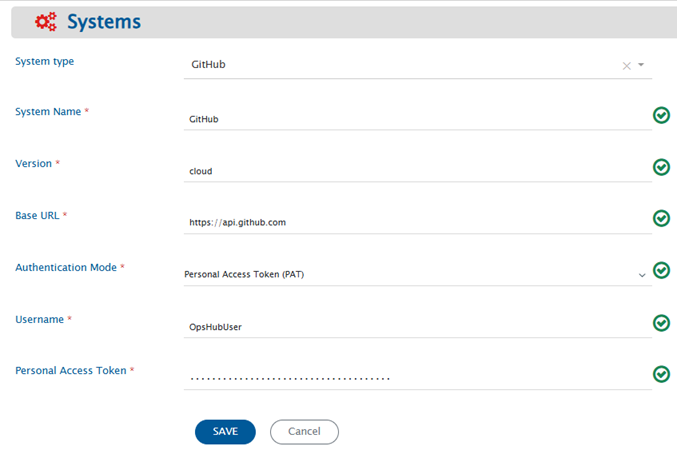
</p>

<p align="center">
    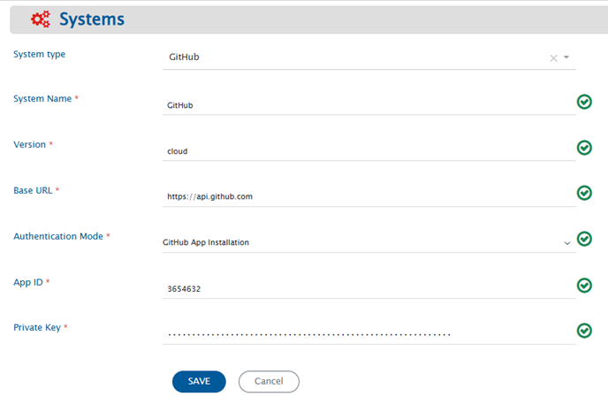
</p>
<br>

If the system is deployed on HTTPS and a self-signed certificate is used, then you will have to import the SSL Certificate to be able to access the system from TEST MEDIAWIKI. Refer to [Import SSL Certificates](../getting-started/ssl-certificate-configuration.md) page for further details.

# Mapping Configuration

Map the fields between GitHub and the other system to be integrated to ensure that the data between both the systems synchronize correctly.  
<br>
Click [Mapping Configuration](../integrate/mapping-configuration.md) to learn the step-by-step process to configure mapping between the systems.  

## Fields available in GitHub

Following is the description of fields that are available in GitHub for mapping configuration:

| **Entity Type**  | **Field Type**              | **Field Name**                    | **Description**                                                                                                                                                                                                                                                                                                                                                        |
|------------------|-----------------------------|-----------------------------------|------------------------------------------------------------------------------------------------------------------------------------------------------------------------------------------------------------------------------------------------------------------------------------------------------------------------------------------------------------------------|
| **Commit**       | Text fields                 | Commit ID                         | Each commit gets a unique identifier in GitHub. This field represents this unique identifier, often called SHA of commit.                                                                                                                                                                                                                                              |
|                  |                             | Files Committed                   | Files that were changed/committed in the commit.                                                                                                                                                                                                                                                                                                                       |
|                  |                             | Branch Name                       | Name of branch in which that commit was done.                                                                                                                                                                                                                                                                                                                          |
|                  |                             | Related Workitem Id(s)            | Related workitem id given in Commit message is based on the regex given in integration configuration. For more details on regex configuration, refer to section [Regex configuration in Integration](#configuring-related-workitem-regex-for-commit-information).                                                                                                      |
|                  | Single-valued user field    | Author                            | Details of user who is author of that commit.                                                                                                                                                                                                                                                                                                                          |
|                  |                             | Committer                         | Details of user who did the commit. Note: Author and Committer can be different or they can be same.                                                                                                                                                                                                                                                                   |
|                  | Date type field             | Commit Date                       | Time the commit was done in repository.                                                                                                                                                                                                                                                                                                                                |
| **Pull Request** | Number type fields          | Number of Commits                 | Number of commits that are present in the created Pull Request.                                                                                                                                                                                                                                                                                                        |
|                  |                             | Files Changed                     | Number of files changed in the commits for which the Pull Request is created.                                                                                                                                                                                                                                                                                          |
|                  |                             | Additions                         | Number of lines added in the commits for which the Pull Request is created.                                                                                                                                                                                                                                                                                            |
|                  |                             | Deletions                         | Number of lines deleted in the commits for which the Pull Request is created.                                                                                                                                                                                                                                                                                          |
|                  |                             | Comments                          | Number of comments in a Pull Request.                                                                                                                                                                                                                                                                                                                                  |
|                  |                             | Review Comments                   | Number of review comments in a Pull Request.                                                                                                                                                                                                                                                                                                                           |
|                  | Boolean type fields         | Locked                            | It shows whether the conversation on Pull Request is locked or not.                                                                                                                                                                                                                                                                                                    |
|                  |                             | Is Draft                          | It shows whether a Pull Request is draft or not.                                                                                                                                                                                                                                                                                                                       |
|                  |                             | Is Merged                         | It shows whether a Pull Request is merged or not.                                                                                                                                                                                                                                                                                                                      |
|                  |                             | Is Mergeable                      | It shows whether a Pull Request can be merged or not.                                                                                                                                                                                                                                                                                                                  |
|                  |                             | Is Rebaseable                     | It shows whether a Pull Request can be rebased or not.                                                                                                                                                                                                                                                                                                                 |
|                  | Text type fields            | Title                             | Pull Request title.                                                                                                                                                                                                                                                                                                                                                    |
|                  |                             | Merge Commit SHA                  | When Pull Request is merged from head branch to base branch, a merge commit is added in the head branch. This field contains the SHA of that merge commit. For more information on value of merge commit sha, kindly refer to section, **Get a single Pull Request** of document [Merge Commit SHA](https://developer.github.com/v3/pulls/#get-a-single-pull-request). |
|                  |                             | Head Branch                       | Name of the branch in which the Pull Request was created. This is known as Head branch.                                                                                                                                                                                                                                                                                |
|                  |                             | Base Branch                       | Name of the branch in which the Pull Request is merged or is going to be merged. This is known as Base branch.                                                                                                                                                                                                                                                         |
|                  |                             | Author Association                | Association of Pull Request author with the repository.                                                                                                                                                                                                                                                                                                                |
|                  |                             | Active Lock Reason                | If a conversation is locked, reason for active lock.                                                                                                                                                                                                                                                                                                                   |
|                  |                             | Mergeable State                   | State of pull request with respect to merge operation.                                                                                                                                                                                                                                                                                                                 |
|                  |                             | Commit Information                | Information of commits associated with a Pull Request - Commit SHA, Commit Message and Author.                                                                                                                                                                                                                                                                         |
|                  | Markdown fields             | Description                       | First comment added while creating the Pull Request.                                                                                                                                                                                                                                                                                                                   |
|                  | Single-valued lookup field  | State                             | State of Pull Request: The current state available for lookup are Open and Closed. If a Pull Request is not merged, then the state is Open and if a Pull Request is merged or rejected, then the state changes to Closed.                                                                                                                                              |
|                  | Multi-valued lookup field   | Labels                            | Labels that can be added to Pull Request: The lookup contains all the labels present in your repository.                                                                                                                                                                                                                                                               |
|                  |                             | Requested Teams                   | Teams that can be added as a Reviewer in Pull Request. The lookup contains all the teams that are added in your organization.                                                                                                                                                                                                                                          |
|                  | Single-valued user field    | User                              | Details of the user who created the Pull Request.                                                                                                                                                                                                                                                                                                                      |
|                  |                             | Merged By                         | Details of the user who merged the Pull Request.                                                                                                                                                                                                                                                                                                                       |
|                  | Multi-valued user field     | Assignees                         | Details of the users assigned to this Pull Request.                                                                                                                                                                                                                                                                                                                    |
|                  |                             | Requested Reviewers               | Details of the reviewers that are added to this Pull Request.                                                                                                                                                                                                                                                                                                          |
|                  | Date type field             | Created At                        | Date when the Pull Request was created in head branch.                                                                                                                                                                                                                                                                                                                 |
|                  |                             | Updated At                        | Date when the Pull Request was updated.                                                                                                                                                                                                                                                                                                                                |
|                  |                             | Closed At                         | Date when the Pull Request was closed. If a Pull Request is in Open state, then Closed At will be null.                                                                                                                                                                                                                                                                |
|                  |                             | Merged At                         | Date when the Pull Request was merged. If a Pull Request is in Open state or is in Closed state and is rejected, then Merged At will be null.                                                                                                                                                                                                                          |
|                  | Reference field             | Milestone                         | Milestone associated with the Pull Request.                                                                                                                                                                                                                                                                                                                            |
| **Issue**        | Text type fields            | Title                             | Issue entity title.                                                                                                                                                                                                                                                                                                                                                    |
|                  |                             | Active Lock Reason                | If a conversation is locked, reason for active lock.                                                                                                                                                                                                                                                                                                                   |
|                  | Number type field           | Comments Number                   | Number of comments in the Issue.                                                                                                                                                                                                                                                                                                                                       |
|                  | Boolean type field          | Locked                            | It shows whether the conversation on Issue is locked or not.                                                                                                                                                                                                                                                                                                           |
|                  | Single-valued lookup fields | State                             | Indicates the state of the entity. It could be either in open state or in closed state.                                                                                                                                                                                                                                                                                |
|                  |                             | State Reason                      | Indicates the state reason of the entity. It could be 'Completed', 'Not_Planned' or 'Reopened'. For more details, refer to [Known Behavior](#known-behaviors) section.                                                                                                                                                                                                 |
|                  | Multi-valued lookup fields  | Labels                            | Labels that can be added to Issue: The lookup contains all the labels present in your repository.                                                                                                                                                                                                                                                                      |
|                  |                             | GitHub Projects                   | GitHub Projects to which the Issue is added. The lookup contains all the projects accessible in the repository owner's account.                                                                                                                                                                                                                                        |
|                  | Reference field             | Milestone                         | Milestone associated with the Issue.                                                                                                                                                                                                                                                                                                                                   |
|                  | Single-valued user field    | User                              | Details of the user who created the Issue.                                                                                                                                                                                                                                                                                                                             |
|                  |                             | ClosedBy                          | Details of the user who closed the Issue. If Issue is in open state, then ClosedBy will be null.                                                                                                                                                                                                                                                                       |
|                  | Multi-valued user field     | Assignees                         | Details of the users assigned to this Issue.                                                                                                                                                                                                                                                                                                                           |
|                  | Markdown type fields        | Description                       | Contains the description of the Issue.                                                                                                                                                                                                                                                                                                                                 |
|                  | Date type field             | Created At                        | Date when the Issue was created.                                                                                                                                                                                                                                                                                                                                       |
|                  |                             | Updated At                        | Date when the Issue was updated.                                                                                                                                                                                                                                                                                                                                       |
|                  |                             | Closed At                         | Date when the Issue was closed. If the Issue is in open state, then Closed At will be null.                                                                                                                                                                                                                                                                            |
|                  | Custom fields               | \<Project Number\>-\<Field Name\> | Custom fields of the GitHub Projects. Refer to [Custom Fields Configuration](#custom-fields-configuration) section for details.                                                                                                                                                                                                                                        |
| **Milestone**    | Text type fields            | Title                             | Milestone entity title. It must be unique within a repository.                                                                                                                                                                                                                                                                                                         |
|                  |                             | Description                       | Description of the Milestone.                                                                                                                                                                                                                                                                                                                                          |
|                  | Number type fields          | Open Issues                       | Number of open issues associated with milestone.                                                                                                                                                                                                                                                                                                                       |
|                  |                             | Closed Issues                     | Number of closed issues associated with milestone.                                                                                                                                                                                                                                                                                                                     |
|                  | Single-valued user field    | Creator                           | Details of the user who created the Milestone.                                                                                                                                                                                                                                                                                                                         |
|                  | Single-valued lookup field  | State                             | Indicates the state of the Milestone. It could be either in open state or in closed state.                                                                                                                                                                                                                                                                             |
|                  | Date type field             | Created At                        | Date when the Milestone was created.                                                                                                                                                                                                                                                                                                                                   |
|                  |                             | Updated At                        | Date when the Milestone was updated.                                                                                                                                                                                                                                                                                                                                   |
|                  |                             | Closed At                         | Date when the Milestone was closed. If Milestone is in open state Closed At will be null.                                                                                                                                                                                                                                                                              |
|                  |                             | Due On                            | Due date of the milestone.                                                                                                                                                                                                                                                                                                                                             |

---

## Inline attachments synchronization

For Markdown fields in **<code class="expression">space.vars.OIM</code>**, GitHub allows to synchronization of inline images.

For **limitations** of Inline image synchronization, refer to [Limitations](#known-limitations) section.

## User Mapping Configuration
**Pull Request, Issue and Milestone entities:**  
* User field synchronization works on the GitHub username. User Lookup based on **Email** is not supported. Hence, the username in both source and target end systems must be same. Otherwise, excel mapping will be required for one-to-one user mapping. Refer below mentioned sample examples.

**Below are few samples of user mapping:**  
<br>  
**Sample 1 - This mapping will work when username in both source and target end systems are same.**

```xml
<Author>
  <xsl:choose xmlns:xsl="http://www.w3.org/1999/XSL/Transform">
    <xsl:when test="SourceXML/updatedFields/Property/user/userEmail">
      <xsl:value-of select="SourceXML/updatedFields/Property/user/userName"/>
    </xsl:when>
    <xsl:otherwise>
      <xsl:value-of select="defaultUserName"/>
    </xsl:otherwise>
  </xsl:choose>
</Author>
```

**Sample 2 - This is an excel mapping example where we need to have an excel file which will have one-to-one user mapping. This will get the username of a user in target end system corresponding to the source system user's username from excel sheet.**

```xml
<Author xmlns:xsl="http://www.w3.org/1999/XSL/Transform" xmlns:xslUtils="http://com.opshub.utils.xslutils.excel.ExcelSheetValueLookup">
  <xsl:choose>
    <xsl:when test="SourceXML/updatedFields/Property/userEmail!=''">
      <xsl:variable name="lookUpEmail" select="xslUtils:lookup('///home///UserEmail information list.xlsx','GitHub to Rally User info list','C','D',SourceXML/updatedFields/Property/userEmail)"></xsl:variable>
      <xsl:choose>
        <xsl:when test="$lookUpEmail !=''">
          <xsl:value-of select="$lookUpEmail"/>
        </xsl:when>
        <xsl:otherwise>
          <xsl:value-of select="SourceXML/updatedFields/Property/user/userName"/>
        </xsl:otherwise>
      </xsl:choose>
    </xsl:when>
    <xsl:otherwise>
      <xsl:value-of select="defaultUserName"/>
    </xsl:otherwise>
  </xsl:choose>
</Author>
```

## Custom Fields Configuration

Custom fields created in GitHub Projects can be assigned values in an Issue entity.

* Text, Number, Date, Single select and Iteration fields are supported. Single select and Iteration fields are available as lookup fields.
* Custom fields are named as - **Project Number + Field Name** (for example, `1-Priority`). Refer to [Get Project Number from GitHub UI](#get-project-number-from-github-ui) to find the project number.
* While writing a custom field, the behavior is same as GitHub UI. The Issue is first associated with the project to which the custom field belongs, and then the field value is assigned.
* Custom fields are available for mapping only for the projects which the integration user can access. Refer to [Authentication types](#authentication-types) for the permissions required.
* Use the **GitHub Projects** field to read and write the GitHub Projects with which an Issue is associated. It is a multi-valued lookup field, so an Issue can be associated with more than one project.
  * If this field is mapped to a single-valued field in the other system, the first project is picked.
  * Projects can only be added to an Issue, not removed. This prevents the loss of custom field values already set for the Issue in that project.
* GitHub Projects (classic) are not supported as GitHub has discontinued them. For more details, refer to [Sunset Notice - Projects (classic)](https://github.blog/changelog/2024-05-23-sunset-notice-projects-classic/).

>**Note**: Custom field updates will only be synchronized if any system field is updated after that.

## Comments Configuration

* Comments can be synchronized for **Issue** and **Pull Request** entity.
* There are 3 types of comments for Pull Request: Issue Comments, Review Comments and Reviews.

>**Note**: Review comments are read-only. Writing them to GitHub needs the commit ID and file path of the reviewed code which are not available in the contenxt of Pull request entity.

# Integration Configuration

Click [Integration Configuration](../integrate/integration-configuration.md) to learn the step-by-step process to configure integration between two systems.


## Configuring Related Workitem Regex For Commit Information

For Commit Information synchronization, you need to specify a **Related Workitem Regex** (Regular Expression) while configuring integration for picking related work item id from the commit message in case of Commit Information.

For example, for commit information, if your commit message is:  
“commiting against TEST-123, added login feature for my website” and the related work item id on which you want to synchronize commit information is TEST-123, then RegEx for your input will be:

```regex
[A-Za-z]+-\d+
```

* Use Case 1 - Create/Update against specific workitem: If you want to create entity against a work item in your target system, then you need to specify a [Target Lookup Query](../integrate/integration-configuration.md#search-in-target-before-sync) for your target system. The parameter for specifying related work item id is @Related Workitem Id(s)@.
  	* Update against existing workitem: This query searches the related work item (for which you specified a RegEx) and will add the entity to TEST-123 according to the field mapping configured. If the entity is found, then the information will be updated on that entity according to the field mapping.
  	* Create new work item, then update: If this entity is not found in your target system and you want integration to create this entity first, and then synchronize source entity to it, then you can set the "If no entity found matching above query?" option in Target Lookup Query to "Create new entity in target".
* Use Case 2 - Create new work item everytime: If you want integration to synchronize and create an entity in your target system for every entity in source system, then provide an incorrect RegEx which will not match your work item id in your commit message. For example, you can provide RegEx as $OpsHub$. Since $OpsHub$ does not match your work item id, the integration will create a new entity in your target system according to the mapping configured. There is no need to enter a Target Lookup Query in this case.

<p align="center">
  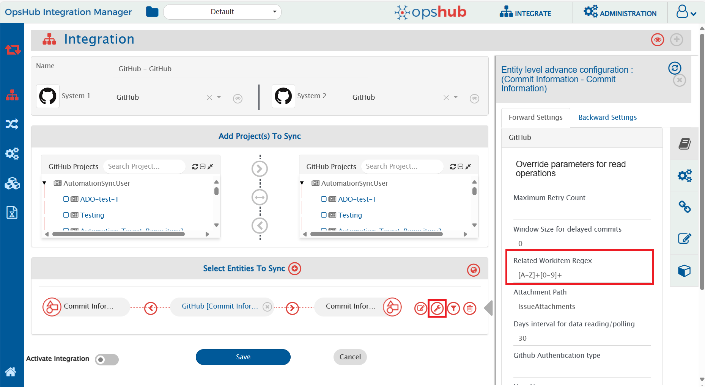
</p>

For knowing the behavior on RegEx matching multiple work items ids, please refer to section [RegEx Known Behavior](#known-behaviors).

>**Note**: This parameter is mandatory for Commit Information.

## Configuring Window Size for delayed commits

Window size for delayed commits is used to fill in the gap between the day commit was done and when the commit was actually pushed into a repository.

Window size for delay commit means the number of days for which the delayed commits are to be synced. For example, if the value is 5 and the poller has processed commits till 21st Jan and someone now pushes a commit that was actually committed on 18th Jan, then that commit will also be picked in the next polling cycle. However, if a commit of 11th Jan is pushed on 21st Jan, it will not be included in the synchronization. If this field is left blank, **1** would be considered as the default value.

<p align="center">
  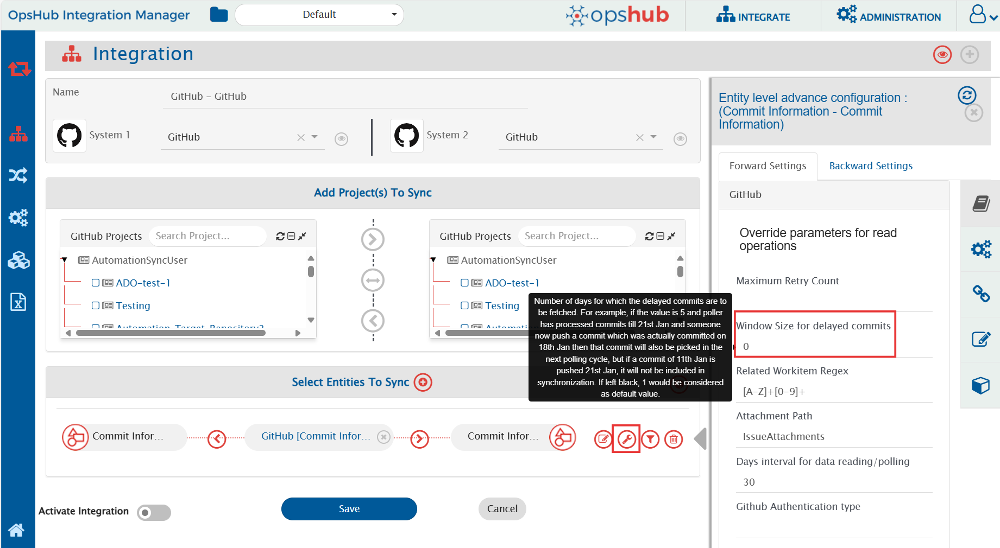
</p>

>**Note**: This parameter is only applicable for Commit Information.

## Configuring Days interval for data reading/polling

Days interval for data reading configures the window for which entities will be polled in one job cycle. For example, if the value is 10, then the data will be polled in intervals of 10 days in one job cycle. The default polling window is 30 days, i.e. entities will be polled for 30 days in one job cycle. This parameter helps in reducing the load on end system.

<p align="center">
  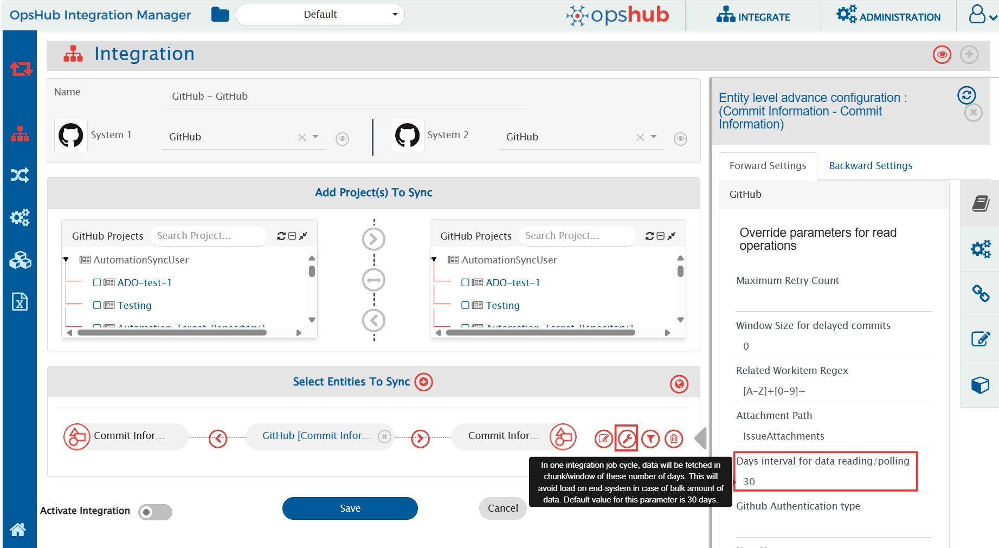
</p>

## Configuring Attachment Path for attachment read/write operations

Attachments for entities are uploaded as repository content. Path to which attachments should be uploaded/read from should be configured at integration level. On this path, folder will be created for each entity with entity Id as the folder name. This folder will contain all attachments associated with given entity Id.

<p align="center">
  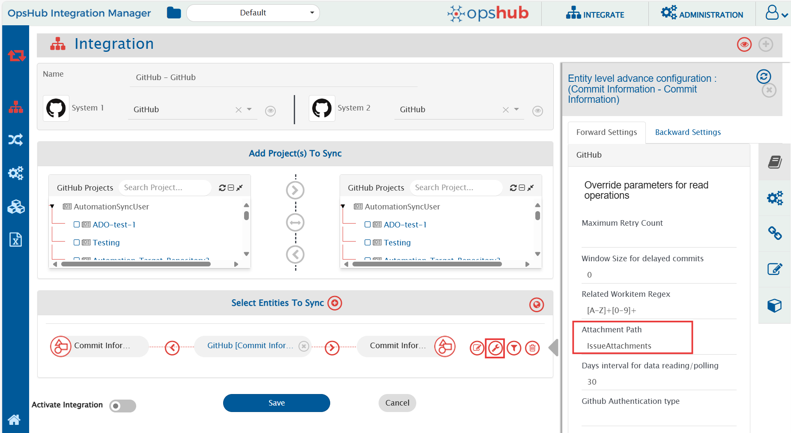
</p>

If attachment path is not provided, there will be processing failure during synchronization. For each attachment synchronization comment will be added in the entity with following content:

* Operation performed + Reference URL of attachment
* Folder path where all entity attachments can be found.

## Criteria Configuration

If you want to specify conditions for synchronizing an entity between GitHub and the other system to be integrated, you can use the **Criteria Configuration** feature.

>**Note**: GitHub Commit Information and Milestone entity doesn't support any criteria polling.

To configure criteria in GitHub, integration needs to be created with GitHub as the source system. The criteria query in GitHub system is a valid GitHub search query that can be used in the GitHub end system UI for search in a repository.

Criteria configuration can be done on fields-State, Author, Assignee, Labels, Milestones, etc. Refer to the document [Searching Issues & Pull Requests](https://help.github.com/en/github/searching-for-information-on-github/searching-issues-and-pull-requests) for more fields on which criteria can be configured.

| Field Type | Criteria Description | Criteria snippet |
|------------|-------------------|----------------|
| **Lookup** | Synchronize all entities which have state as Open | state:open |
| **Lookup** | Synchronize all entities which do not have state Closed | -state:closed |
| **Date** | Synchronize all entities closed after certain date | closed:>2018-04-14 |
| **Text** | Synchronize all entities which contain 'PR' in title field | PR in:title |
| **User** | Synchronize all entities which were created by user 'Robert' | author:Robert |
| **User** and **Text** | Synchronize all entities that were created by user 'Robert' and have 'PR' in title | PR in:title author:Robert |
| **Multivalued lookup** and **Text** | Synchronize all entities that have Label set as 'bug' but not 'invalid' and which have text 'pull' in 'title' or 'description' field | pull in:title,body label:bug -label:invalid |
| **OR criteria using AND and NOT** | Consider that there are following labels in a repository - bug, abc, duplicate, documentation and invalid. This will synchronize all entities that have label documentation or invalid or both. | -label:bug -label:abc -label:duplicate |
| **OR criteria** | Synchronize all entities which are in Closed state and have either 'PR' in title or 'ER' in description(body) fields | is:closed PR in:title OR ER in:body |

In GitHub, search can be done on either text in a field or for some value of a lookup field. When doing search for a text in a field, we can add AND, OR and NOT operators in search criteria. Refer to criteria sample 'OR criteria' in the above table. For searching a particular value of a lookup field like label or user, then we can only provide AND and NOT operators in criteria query. Refer to criteria sample 'OR criteria using AND and NOT' in the above table.

Refer to document [Search Syntax in GitHub](https://help.github.com/en/github/searching-for-information-on-github/understanding-the-search-syntax) for more information on constructing search query.

# Known Behaviors

* API Rate Limitation in GitHub:
  * GitHub has limitation on API access per minute for a single user. Due to this, <code class="expression">space.vars.OIM</code> can access GitHub API within a limit. When the limit exceeds, the GitHub API stops responding for certain amount of time, and no API calls can be done by <code class="expression">space.vars.OIM</code> during that time until GitHub resets the limit for that user.
  * For GitHub Cloud instance, the rate limit for Search API is 30 requests per minute, and other APIs have the rate limit of 5000 requests per hour whereas for GitHub on-premise instance, the rate limit is configurable. For configuring rate limit on GitHub on-premise, refer to the document [Configuring Rate Limits](https://help.github.com/en/enterprise/2.20/admin/installation/configuring-rate-limits).
  * To address this issue, we have added wait time in entity synchronization. Thus, there might be some delay in synchronization. For more information on API rate limitations, refer to document [Rate Limits](https://developer.github.com/v3/#rate-limiting).
  * There are some measures that can be taken to experience less delay in synchronization.
    * We can configure multiple integrations for synchronizing multiple GitHub repositories with different set of GitHub users, so that rate limit has less impact on synchronization time.
    * If you have an on-premise GitHub instance, then you can either have no rate limit for API or you can have a large API rate limit to experience less delay in synchronization.
* Related Workitem Id(s) field behavior:
  	* If multiple work item ids are found in commit message that satisfy the Regex provided in integration configuration, by default, the first one gets picked up in Related Workitem Id(s) and is sent forward for synchronization.
  	* If any workitem id is not found, then it shows -1 in field Related Workitem Id(s).
* **State_reason** field behavior for **Issue** entity:
  	* This field is dependant on **State** field.
   		 * Reason: For closing status, we have two options in GitHub **Completed** & **Not_Planned**. For opening an issue from close state, the reason will be **reopen**. Hence, State Reason field is mandatory, if we want to sync the states properly.  Or else, the State field will be synced with the default behaviour of GitHub.
* Only 1200 issues can be added to a GitHub project. If more than that are attempted to be added, it will lead to processing failures.

# Known Limitations

## Common
* For GitHub Markdown fields:
  * Synchronization of inline document is not supported for Markdown fields of GitHub.
  * Inline images which refer to the checked-in files in the repository won't be synchronized by <code class="expression">space.vars.OIM</code>. In such cases, the source inline image URL will be written in the target system as it is.
  * Inline image synchronization for comments is not supported currently for GitHub as a target system due to API limitation. It will sync as a inline file.
  * Inline document synchronization for comments is not supported currently for GitHub as a target system due to API limitation.

## Commit
* GitHub Commit information entity doesn't support any criteria-based polling.

## Milestone
* GitHub Milestone entity doesn't support any criteria-based polling.

## Pull Request
* For pull request creation, head and base branches are mandatory. Also, difference and commits must be there between the two branches. Otherwise, processing failure will be generated.
* For GitHub Pull Request, the current values for status field are Open and Closed.
  * Going forward, if GitHub introduces a new status, then user can use it with the help of advanced mapping.
* History based synchronization is supported only for the State field of Pull Request.

## Issue entity
* Deleting an Issue is not supported, as GitHub provides no API for it. An Issue can only be deleted from GitHub UI by its owner.
* History based synchronization is not supported because of API unavailability.
* Removal of a project from the **GitHub Projects** field is not supported. Refer to [Custom Fields Configuration](#custom-fields-configuration) for details.
* User Lookup based on **Email** is not supported due to API unavailability. For more information, refer to [User Mapping Configuration](#user-mapping-configuration) section.

## Entity Mention
**Github as Source**:
* Any text in GitHub that follows the entity mention format will be treated as an entity mention, even if the entity does not exist in the target system. The GitHub API returns issue references as they appear, without distinguishing whether they have been auto-linked. This can result in non-existent issue numbers being treated as valid mentions, potentially leading to URLs in the target system that redirect to a 404 page on GitHub.

**Github as Target**:
* When synchronizing rich text from a source system to GitHub, any text formatted as a supported entity mention will be automatically converted to an entity mention if a corresponding issue exists in GitHub.
* In a bidirectional synchronization scenario, if an entity mention is unintentionally created due to GitHub’s auto-linking, it will be treated as a valid mention when syncing back, behaving as if GitHub is the source.
* When synchronizing rich text that contains adjacent entity mentions (without spaces between them), GitHub may generate a hyperlink only for the last mention, even if both correct links are sent to the GitHub API. This can lead to incomplete or inaccurate linking in the final output.

**Example**: In Source System A, the text is "#1#2". After synchronization, GitHub will display this as "12" with a hyperlink redirecting to the URL of the entity with identifier "2," assuming the mention settings include the source URL option.

# Appendix
## Create Personal Access Token

* Log in with the integration user in GitHub Cloud.  
* Click on your user name at top right corner and select **Settings** option.

<p align="center">
  
</p>

* Select **Developer Settings** as shown below:

<p align="center">
  
</p>

* Select **Personal access tokens** and click **Generate new token** option:

<p align="center">
  
</p>

* Provide the Note for the token and select **repo** scope. Then click **Generate token** button at the bottom:

<p align="center">
  
</p>

* Copy the token value and save it for future use:

<p align="center">
  
</p>

## Register GitHub App
#### While registering a GitHub App, follow below-mentioned steps:
  * Log in with the OIM dedicated user in GitHub.
  * In the upper-right corner on GitHub, click your profile picture & click 'Settings'. 
  * In the left sidebar, click 'Developer settings'. 
  * In the left sidebar, click 'GitHub Apps' & click 'New GitHub App'.
<p align="center">
  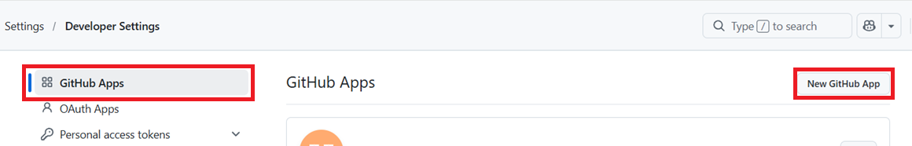
</p>

  * Provide GitHub App name.
<p align="center">
  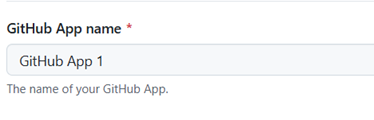
</p>

  * In 'Homepage URL', type the full URL to your GitHub app's website or type the URL of the account that owns the app.
<p align="center">
  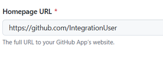
</p>

  * Uncheck 'Active' checkbox in Webhook section.
<p align="center">
  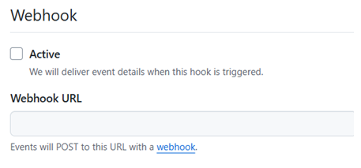
</p>

  * Select 'Any account'.
<p align="center">
  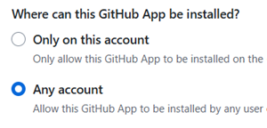
</p>

  * Click 'Create GitHub App'.

## Configure Private Key in OIM
####  After generating the private key, follow below-mentioned steps:
  * After generating private key, You will see a private key in PEM format downloaded to your computer.
  * Remove "--BEGIN RSA PRIVATE KEY--", "--END RSA PRIVATE KEY--" & new lines.
    * After this, your private key should look like: "MIIEogIBAAKCAQEAuflHHAj2HF.....", without breaking line.
  * Provide this as Private key while configuring GitHub system in OIM.

## Get Project Number from GitHub UI

The project number is used in the display name of custom fields, for example `6-Priority`. To get the project number of a GitHub Project:

* Log in to GitHub and open the project.
* The number at the end of the project URL is the project number. For example, in the URL `https://github.com/users/AutomationSyncUser/projects/6`, the project number is **6**.

<p align="center">
  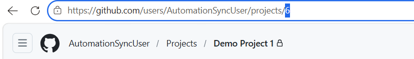
</p>
