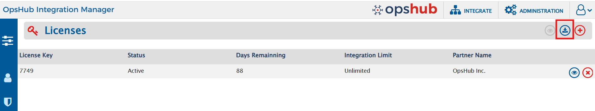
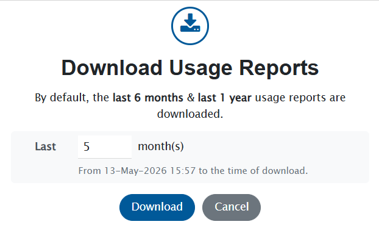

# Overview

The **Usage Reports** feature enables administrators to export detailed system usage data for analysis and licensing purposes. Reports can be downloaded directly from the **Licenses screen** or through the **Admin API**, providing a convenient and efficient way to access usage information.

By default, the exported report is provided as a **Usage Reports.zip** file, which contains two Excel reports:

- **Usage Report (Last 6 Months)**
- **Usage Report (Last 1 Year)**

Administrators can also download the usage report for a period of their choice, from the **last 1 month** up to the **last 12 months**. In this case, a single Excel report, **Usage Report (Last N Months)**, is downloaded directly, without a ZIP file. For example, choosing 1 month downloads **Usage Report (Last 1 Month).xlsx**. This is useful for periodic reporting, such as a monthly usage review.

Each report includes both **summary and detailed insights** about activity across integrated systems. The reports provide information such as unique users, integrated projects, integrated entity types, synced data, and detailed information about processed users across systems.

User activity is captured across multiple interaction points, including mapped user fields, comments, attachments, user mentions, and updates. This helps provide a comprehensive view of system usage and user interactions across integrations.

These reports help administrators review usage patterns, monitor integration activity, and obtain the necessary insights for operational analysis and licensing purposes.

---

# Prerequisites

To access and download the reports, the user must:

- Have an **Administrator role**
- Have **Read permission for Server Management**

---

# Report Period

Every usage report starts at the **same date and time, N months before** the report is downloaded, and ends at the **time of download**. The default reports follow the same rule, with N = 6 for the **Last 6 Months** report and N = 12 for the **Last 1 Year** report.

For example, if the report is downloaded on **15-Oct-2026 at 10:30**:

| Report | Period covered |
|--------|----------------|
| Last 1 month | 15-Sep-2026 10:30 to 15-Oct-2026 10:30 |
| Last 3 months | 15-Jul-2026 10:30 to 15-Oct-2026 10:30 |
| Last 6 months (default) | 15-Apr-2026 10:30 to 15-Oct-2026 10:30 |
| Last 1 year (default) | 15-Oct-2025 10:30 to 15-Oct-2026 10:30 |

- If the same date does not exist in the earlier month, the last day of that month is used. For example, a 1 month report downloaded on 31-Mar starts on 28-Feb (29-Feb in a leap year).
- The period is calculated in the time zone of the server.
- Choosing 6 months gives the same numbers as the default **Last 6 Months** report, and choosing 12 months gives the same numbers as the default **Last 1 Year** report.
- The exact **From** and **To** dates of a report are shown on its **Summary** sheet.

> **Note**: A report always ends at the time of download, so it cannot be generated again later for a past period. If you need a usage report for each month, download the **Last 1 month** report at the same date and time every month, for example on the 1st of every month, and save each file. Each month's report then continues from where the previous one ended, without any gap or overlap.

---

# Download Usage Reports 
## Using UI

Follow these steps to download the usage reports from the application:

1. Navigate to the **Licenses** screen.
2. Locate the **Download usage reports** button on the screen, as shown in the image below. The button is highlighted with a red rectangular box.
3. Click the **Download usage reports** button. The **Download Usage Reports** dialog opens.
4. Choose the report to download:
    - To download the default **Last 6 Months** and **Last 1 Year** reports, leave the **Last [ ] month(s)** field empty.
    - To download the report for a period of your choice, enter a whole number from **1** to **12** in the **Last [ ] month(s)** field. The period covered by the report is shown below the field, for example **From 15-Sep-2026 10:30 to the time of download.**
5. Click **Download**.
    - If the field is empty, the **Usage Reports.zip** file is downloaded to your browser’s default download location. Extract the ZIP file to access the reports.
    - If a number of months is entered, the **Usage Report (Last N Months).xlsx** file is downloaded to your browser’s default download location.

> **Note**: If the value entered is not a whole number from 1 to 12, an error message is shown below the field and the **Download** button is disabled. Correct the value, or clear the field to download the default reports.

To close the dialog without downloading a report, click **Cancel**.

## Using Admin API

Administrators can also download the usage reports using the Admin API.

**Endpoint**
GET `/export/usage-reports`

**Query Parameter**

| Parameter | Required | Description |
|-----------|----------|-------------|
| `months` | No | Number of months to report on, a whole number from 1 to 12. Omit it to download the default reports. |

**Examples**

- GET `/export/usage-reports` – Downloads the default reports.
- GET `/export/usage-reports?months=1` – Downloads the report for the last 1 month.

**Response**

- Without the `months` parameter, returns the **Usage Reports.zip** file.
- With the `months` parameter, returns the **Usage Report (Last N Months).xlsx** file, without a ZIP file.
- If the value of `months` is not a whole number from 1 to 12, the API returns an error with HTTP status **400 (Bad Request)** and the following message, and no file is downloaded:
  `Invalid value '<value>' for months. Please enter a whole number between 1 and 12.`

## Using MCP

The usage reports can also be downloaded through the MCP server, using the `export_usage_report` tool. The tool takes an optional `months` input, a whole number from 1 to 12:

- Without `months`, the tool returns the **Usage Reports.zip** file with the default reports.
- With `months`, the tool returns the **Usage Report (Last N Months).xlsx** file.

For example, you can ask the AI assistant: *"Export the usage report for the last 3 months."* For more details, refer to [MCP Available Tools](../mcp/mcp-available-tools.md#reporting-tools).

---

# Contents of the Downloaded File

After extracting **Usage Reports.zip**, the following files will be available:

- `Usage Report (Last 6 Months).xlsx`
- `Usage Report (Last 1 Year).xlsx`

When a number of months is chosen, a single file is downloaded instead, named after the chosen period. For example:

- `Usage Report (Last 1 Month).xlsx`
- `Usage Report (Last 3 Months).xlsx`

Each Excel report contains the following sheets:

1. `Summary`
2. `Unique User Count`
3. `Entity Type Count`
4. `Integrated Project Count`
5. `Synced Data Count`
6. `Detailed User Report`

## Summary Sheet

This sheet provides an overall summary of all the reports included in the Usage Reports. It gives a quick overview of key metrics, allowing administrators to quickly understand system usage and user activity.

### Example

### Explanation of Metrics

- **Total Unique Users** – Displays the total number of unique users observed across all systems, with a breakdown based on available identifiers such as emails, display names, and usernames.
- **Total Unique Entity Types** – Shows the total number of different entity types involved in synchronization across the systems.
- **Total Unique Projects** – Represents the total number of integrated projects observed during the selected period.
- **Total Entities Synced** – Counts all entities that were successfully synchronized between systems.

This summary sheet provides a **high-level overview of system usage**, allowing administrators to quickly assess usage from a single sheet instead of reviewing each detailed report individually.

---

## Unique User Count Sheet

Displays the total number of unique users identified across integrated systems, along with a system-wise breakdown.

### Explanation of Columns

- **System / Source** – The system where the users were detected.
- **Count** – Total number of unique users identified in the system.
- **Identifiers** – Breakdown of how users were identified, following a **priority order**:
    1. **Usernames or Emails** – Users matched using **username or email** when both fields are available. If either username or the local part of email (case-insensitive) matches an existing user, it is considered the same user. **This is the highest priority.**
    2. **Emails** – Users identified **by email only** when no match was found using username or username/email combination in the first step.
    3. **Display Names** – Users identified by display name if no email is available.
    4. **Usernames** – Users identified by username if both email and display name are empty.

This information helps administrators understand how user identities are detected and matched across different integrated systems.
### Example

---

## Entity Type Count Sheet

Displays the entity types involved in synchronization across system pairs during the selected period.

### Explanation of Columns

- **System Pairs** – The pair of systems involved in synchronization.
- **End System** – The system where the entity resides or is synced to.
- **Entity Types** – The types of entities synced between the systems.
- **Status** – The current status of the integration (Active or Inactive).
- **Last Synced** – The most recent timestamp when the entity was successfully synced.

---

## Integrated Project Count Sheet

Lists the unique project pairs that were involved in integrations during the selected timeframe, along with their status and last updated time.

### Explanation of Columns

- **End System 1 / End System 2** – The source and target systems involved in the integration.
- **End System 1 Project / End System 2 Project** – Source and target projects participating in the integration.
- **Status** – The current status of the integration (Active or Inactive).
- **Last Updated** – The timestamp when the integration was last updated.
- **Last Synced** – The timestamp when the last entity was successfully synced between the project pair.

This table provides a **clear view of project-level integrations**, helping administrators monitor integration activity and identify inactive or outdated integrations.

---

## Synced Data Count Sheet

Displays the total number of entities successfully synchronized between integrated system pairs.

### Explanation of Columns

- **End System 1 / End System 2** – The source and target systems between which entities are synchronized.
- **Counts Based on System Pair** – The total number of entities successfully synced between the two systems.
- **Last Synced** – The most recent timestamp when entities were fully synchronized.

---

## Detailed User Report Sheet

The **Detailed User Report** sheet provides comprehensive information about each observed user across integrated systems.

The report includes the following information:

- **Email** – User email address
- **Username** – Username of the user
- **Display Name** – Display name of the user
- **Interaction Types** – Areas where the user was detected (such as comment authors, attachment authors, mapped user fields, mentions in rich text fields, etc.)
- **Observed In** – Systems where the user was detected, along with timestamps
- **Service Account** – Indicates whether the user is used as a service account
- **Last Seen** – The last observed activity time of the user in the system
- **Duplicates** – Identifies users with matching email IDs but different usernames across systems

