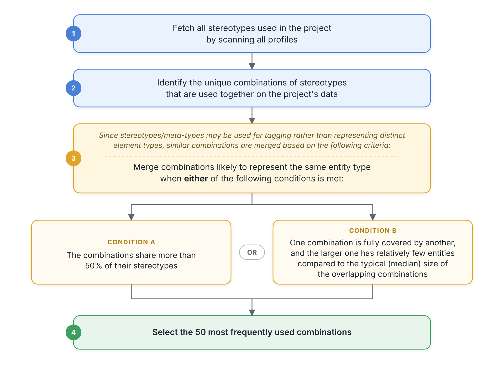

# Automatic Element Type Detection (MBSE)

## Overview

For MBSE-based systems, the system-level Element Meta JSON input is optional. OIM automatically derives the element type groupings for the project selected in the integration or mapping, based on the data available in the end system.

These groupings are stored in the system-level Element Meta JSON input and are used to populate the element types available for mapping and integration configuration.

In most cases, the generated definitions can be used as-is. Manual changes are required only when the derived groupings do not match the intended business requirements or synchronization scope.

No additional configuration is required to enable automatic detection.

## How Element Types Are Derived

OIM follows these steps to derive element types:

  

## Automatic Refresh and Protection

During refresh, OIM maintains the derived element type definitions based on changes in the end-system data.

| Scenario | OIM Behavior | Example |
|---|---|---|
| New stereotype/meta-type combination | Discovers the new combination as an element type and makes it available in mapping and integration configurations. | An element tagged with the `Block` and `Control` stereotypes is added to the end system. OIM discovers this combination and loads it as a new element type. |
| Additional stereotype/meta-type on existing elements | Updates the corresponding element type definition during refresh, provided it has not been configured in an integration or manually modified. | An additional `BOM` stereotype is applied to an element already tagged with the `Block` and `ConstraintBlock` stereotypes. The existing element type definition is updated to include the `BOM` stereotype. |
| Change in stereotype/meta-type tagging | Updates the corresponding element type definition during refresh, provided it has not been configured in an integration or manually modified. | An element tagged with the `Block` and `Control` stereotypes is updated to have the `Block` and `ConstraintBlock` stereotypes in the end system. The existing definition is updated to the `Block` and `ConstraintBlock` combination. |

- To prevent unintended changes to the synchronization scope, OIM does not automatically modify element type definitions that have been manually modified or configured in an integration.
- The `refreshRestrictedDueTo` property in the element type definition indicates why OIM has excluded that element type from refresh. It has the following possible values:

  | Value | Description |
  |---|---|
  | `USER_MODIFIED` | The element type definition was manually modified. |
  | `CONFIGURED_IN_OIM` | The element type was configured in an integration. |

When neither restriction applies, OIM can automatically update the definition during refresh.

## Scenarios Requiring Manual Updates

Sometimes, the groupings derived through automatic detection do not match the intended business requirements. In such cases, the system-level Element Meta JSON input must be updated.

### 1. Different Element Types Merged into One Grouping

Similarity-based merging may combine stereotype/meta-type combinations that represent different business-level element types.

**Example:**

The following combinations may represent three distinct element types:

- Elements tagged with the `Block`, `BOM`, and `Control` stereotypes.
- Elements tagged with the `Block` and `Control` stereotypes.
- Elements tagged with the `Block`, `Physical`, and `Control` stereotypes.

If these combinations are merged during detection, separate element type definitions must be created in the JSON to preserve the intended distinctions.

### 2. Same Element Type Split into Multiple Groupings

Some combinations may represent the same conceptual element type but may not meet the similarity criteria for automatic merging.

**Example:**

The following combinations may represent a single element type:

- Elements tagged with the `Block` and `Logical` stereotypes.
- Elements tagged with the `Block`, `Physical`, and `Control` stereotypes.

If both combinations represent the same business-level element type, they must be consolidated into a single element type definition in the JSON.

### 3. Excluding Stereotype/Meta-Type-Tagged Elements

Certain elements tagged with specific stereotypes/meta-types may not be intended for synchronization.

The exclusion can be configured at either of the following levels:

- **System level:** Specify the stereotypes/meta-types in `excludingStereotypes` in the system-level Element Meta JSON input. The exclusion applies across integrations.
- **Integration level:** Configure the exclusion using [criteria](criteria-configuration.md). The exclusion applies only to the respective integration.

### 4. Stereotype/Meta-Type Changes to a Protected Element Type

When stereotype/meta-type tagging changes in the end system, the corresponding element type definition is updated during refresh if it has not been configured in an integration or manually modified.

However, if the existing definition is configured in an integration or has been manually modified, it is treated as a protected definition. In this case, a new element type is created for the updated combination during refresh.

**Example:**

Elements previously tagged with the `Block` and `Control` stereotypes are updated to have the `Block` and `BOM` stereotypes in the end system.

If the existing `{Block, Control}` element type definition is configured in an integration or has been manually modified, OIM adds `{Block, BOM}` as a new element type during refresh.

If this updated combination needs to be included in the synchronization, review the resulting definitions to determine how to handle it:

- **Incorporate the changes into the existing element type:** Update the existing definition in the system-level Element Meta JSON input to include the new combination.
- **Treat it as a separate element type:** Retain the existing definition as-is and configure the newly discovered element type separately in the integration.