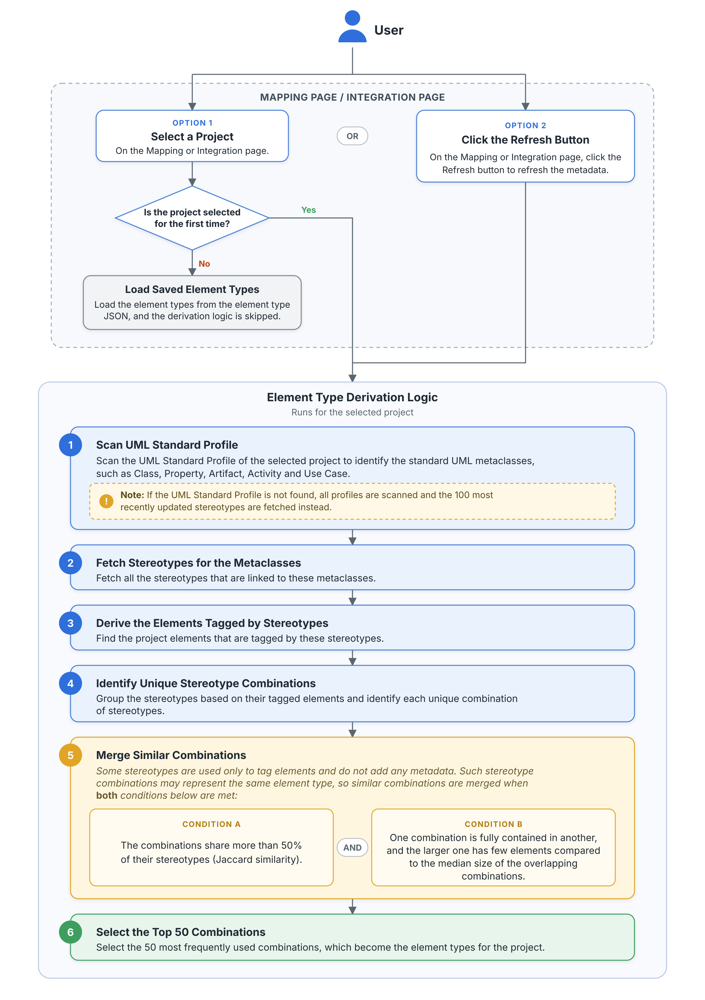

# Automatic Element Type Detection (MBSE)

## Overview

For MBSE-based systems, element types (entity types in OIM) are a combination of the UML/SysML types and a list of stereotypes. The details of this grouping are stored in the system-level Element Meta JSON input. This input is optional for the user, as OIM automatically derives the element type groupings for the project selected in the integration or mapping, based on the data available in the end system. These groupings are used to populate the element types available for mapping and integration configuration.

In most cases, the generated definitions can be used as-is. Manual changes are required only when the derived groupings do not match the intended business requirements or synchronization scope.

No additional configuration is required to enable automatic detection.

## How Element Types Are Derived

OIM follows these steps to derive element types:

  

## Known Behavior

Generally, in OIM, entity types are updated automatically when a new entity types are added to the end system. However, for MBSE-based systems, entity types are fetched only in the following situations:
- When entity types are fetched for the first time for a given project.
- When the user explicitly clicks refresh button on the Mapping or Integration page to refresh the metadata.

This behavior is intentional because discovering element types in an MBSE system is a resource-intensive process that involves multiple API calls to retrieve UML metaclasses, profiles, and associated stereotypes. Therefore, OIM does not repeat this discovery process every time element types are required. Instead, it performs the derivation only when explicitly triggered.

### Element Type Metadata Refresh Behavior

During a metadata refresh, OIM compares the newly derived element type definitions with the existing definitions and updates them based on changes in the end-system data.

The following scenarios describe how OIM handles changes during a refresh:

| Scenario                                                                                                                                                                                                                                                         | OIM Behavior                                                                                                                                                                                                                       |
|------------------------------------------------------------------------------------------------------------------------------------------------------------------------------------------------------------------------------------------------------------------|------------------------------------------------------------------------------------------------------------------------------------------------------------------------------------------------------------------------------------|
| New elements are added to the end system with a stereotype combination that was not previously present. For example, an element tagged with the `Block` and `Control` stereotypes is added.                                                                    | When the user refreshes metadata on the Mapping or Integration page, OIM derives and adds a new element type corresponding to the new combination of `{Block, Control}` to the entity type list.                                   |
| An additional stereotype is applied to an element, and/or an existing stereotype is removed from it in the end system. For example, the `BOM` stereotype is applied to an element that was previously tagged with the `Block` and `ConstraintBlock` stereotypes. | When the user refreshes metadata, OIM updates the corresponding element type definition to reflect the changed stereotype combination, provided that the definition has not been modified by the user or configured in an integration. |

To prevent unintended changes to the synchronization scope, OIM does not automatically modify element type definitions that have been manually modified by the user or configured in an integration. The `refreshRestrictedDueTo` property, defined at the element type definition level in the system-level Element Meta JSON input, indicates why OIM has excluded a particular element type definition from automatic updates during metadata refresh.

The property can have the following values:

  | Value | Description                                                                                  |
  |---|----------------------------------------------------------------------------------------------|
  | `USER_MODIFIED` | The element type definition is modified by the user in the system-level Element Meta JSON input. |
  | `CONFIGURED_IN_OIM` | The element type is configured in an OIM integration.                                        |

When neither of these restrictions applies, OIM can automatically update the corresponding element type definition during metadata refresh.

### Scenarios Requiring Manual Updates

In some cases, the element types derived by OIM may not align with the intended business requirements. This is because the automatic grouping and merging logic is based on stereotype combinations and their usage in the end system, which may not reflect the intended business-level element types.

In such cases, the system-level Element Meta JSON input must be updated to define the required element type groupings explicitly.

The following scenarios describe when such manual updates may be required.

### 1. Different Element Types Merged into One Grouping

OIM may merge multiple stereotype combinations into a single combination based on the similarity criteria used during automatic derivation. However, these combinations may represent different business-level element types and therefore need to be maintained separately.

**Example:**

Consider the following stereotype combinations in the end system:

- Elements tagged with the `Block`, `BOM`, and `Control` stereotypes.
- Elements tagged with the `Block`, `Physical`, and `Control` stereotypes.

Since both combinations share more than 50% of their stereotypes, OIM may merge them into a single grouping containing the common stereotypes: `{Block, Control}`.

However, if these combinations represent distinct business-level element types, they must be defined separately.

**Required action:**

Update the system-level Element Meta JSON input:

- Add separate element type definitions for both combinations: `{Block, BOM, Control}` and `{Block, Physical, Control}`.
- Remove the automatically derived element type definition related to `{Block, Control}` combination, as it no longer represents the intended grouping.

### 2. Same Element Type Split into Multiple Groupings

Some stereotype combinations may represent the same conceptual element type because certain stereotypes are used only for tagging or classification purposes and do not introduce any distinct metadata definitions such as fields. However, these combinations may not satisfy the automatic similarity-based merging criteria. In such cases, OIM may derive them as separate element types.

**Example:**

Consider the following stereotype combinations in the end system:

- Elements tagged with the `Block` and `Logical` stereotypes.
- Elements tagged with the `Block`, `Physical`, and `Control` stereotypes.

Although these combinations may represent the same business-level element type, they do not satisfy either of the automatic merging conditions. Consequently, OIM derives two separate element types, corresponding to the following stereotype combinations:

- `{Block, Logical}`
- `{Block, Physical, Control}`

If both combinations are intended to represent the same element type, they can be consolidated into a single grouping containing their common stereotype: `{Block}`.

**Required action:**

Update the system-level Element Meta JSON input to:

- Add a single element type definition for `{Block}` to cover both combinations.
- Remove the separately derived element type definitions corresponding to the `{Block, Logical}` and `{Block, Physical, Control}` combinations.

### 3. Excluding Stereotype-Tagged Elements

Certain elements tagged with specific stereotypes may not be intended for synchronization. Such elements can be excluded by configuring the relevant stereotypes at either of the following levels:

- **System level:** Specify the stereotypes in the `excludingStereotypes` property of the applicable element type definition in the system-level Element Meta JSON input. This exclusion applies across all integrations that use the corresponding element type.
- **Integration level:** Configure the exclusion using [criteria](criteria-configuration.md). This exclusion applies only to the respective integration.

### 4. Stereotype Changes to a Protected Element Type

When the stereotypes applied to elements are changed in the end system, OIM updates the corresponding element type definition during metadata refresh, provided that the definition has not been modified by the user or configured in an integration.

However, if the existing element type definition is modified by the user or configured in an integration, OIM treats it as a protected definition and does not update it during refresh. Instead, OIM derives and adds a new element type corresponding to the updated stereotype combination.

**Example:**

Consider the following change in the end system:

- Initially, elements are tagged with the `Block` and `Control` stereotypes.
- Subsequently, the `Control` stereotype is removed and the `BOM` stereotype is applied, resulting in the `{Block, BOM}` combination.

If the existing `{Block, Control}` element type definition has been manually modified or configured in an OIM integration, upon refreshing metadata from the Mapping or Integration page, OIM will:

- Retain the existing `{Block, Control}` element type definition without modifying it.
- Add a new element type definition corresponding to the updated `{Block, BOM}` stereotype combination.

**Required action:**

Depending on how the updated combination needs to be handled, one of the following approaches can be used:

- If the updated elements should be synchronized as part of the existing entity type, update the existing element type definition corresponding to `{Block, Control}` to include the `{Block, BOM}` combination. Remove the separately derived `{Block, BOM}` definition from the system-level Element Meta JSON input.
- If the updated elements should be synchronized using a separate entity type configuration, no changes to the system-level Element Meta JSON input are required.